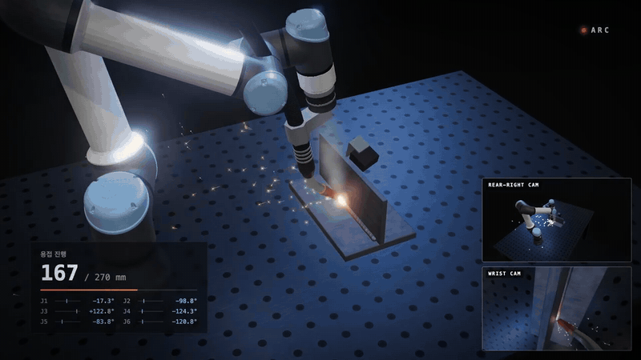

# welding-simulation



UR5e 로봇과 사람이 용접 시편을 용접하는 장면을 three.js로 만들고, 장면에 단 카메라들의 영상까지 MP4로 뽑는 시뮬레이션 툴입니다. 프레임은 영상 시간 t만의 순수 함수입니다. 그래서 브라우저에서는 아무 시점으로나 스크럽할 수 있고, 헤드리스 Chrome으로 렌더하면 매번 같은 영상이 나옵니다.

- **로봇:** IK로 용접선 전체를 미리 풀어 둔 궤적을 재생합니다(위빙, 접근, 후퇴 포함).
- **사람:** 자동 리깅한 작업자가 토치 손잡이를 손 IK로 잡고 따라갑니다.
- **용접 표현:** 두 경우 모두 비드가 자라고 식는 것, 아크, 스패터, 소리(아크 지글거림, 서보 소리)가 나옵니다.

## 시작하기

Node.js 18 이상, Google Chrome, ffmpeg가 필요합니다. macOS에서 확인했습니다. Linux와 Windows는 Chrome 기본 경로와 GL 설정을 넣어 두었지만 아직 돌려 보지 않았습니다.

```bash
npm install
npm run dev                                   # http://localhost:5180/?project=example-robot (스페이스: 재생/정지, 슬라이더: 스크럽)
npm run stills -- 2,12,24 --project example-robot                    # -> out/stills/example-robot/t*.jpg
npm run render -- --project example-robot [--draft]                  # -> out/example-robot.mp4
npm run render -- --project example-robot --query view=wrist         # -> out/example-robot-wrist.mp4 (손목 카메라 영상)
npm run render -- --project example-human --query gap=3              # 갭 3 mm 시편
```

- 결과물은 모두 `out/`에 생기고, `out/`은 git에 올라가지 않습니다.
  - **영상:** `out/<id>[-<param><값>][-<view>][-draft].mp4`. 예: `out/example-robot-gap3-wrist-draft.mp4`
  - **스틸:** `out/stills/<id>[-...]/t<초>.jpg`
- `--draft`는 720p로 빠르게 뽑습니다.
- `--from`과 `--to`로 구간만 렌더할 수 있습니다.
- Chrome이 기본 경로에 없으면 `CHROME` 환경변수로 경로를 지정합니다.

## 나레이션과 배경음악 (OpenRouter)

OpenRouter API 키 하나로 나레이션(ElevenLabs)과 배경음악(Google Lyria)을 둘 다 만들 수 있습니다. ElevenLabs나 Google에 따로 가입하거나 구독할 필요 없이 쓴 만큼만 OpenRouter 크레딧에서 나갑니다.

```bash
cp .env.pub .env          # OPENROUTER_API_KEY="sk-or-..." 를 채움 (.env는 git에 안 올라감)
node scripts/narrate.mjs --project <id> --lang ko                         # projects/<id>/narration.js -> narration/ko/*.mp3
node scripts/music.mjs projects/<id>/music.txt projects/<id>/music.mp3    # 프롬프트 한 문단 -> 곡 하나
```

| 용도 | 모델 | 비용(실측) |
|---|---|---|
| 나레이션 | `elevenlabs/eleven-v4` (OpenRouter `/api/v1/audio/speech`) | 한국어 83자(음성 12.6초)에 $0.0066. 1,000자에 약 $0.08, 음성 1분에 약 $0.03 |
| 배경음악 | `google/lyria-3-pro-preview` (chat completions, 오디오 출력) | 곡 하나에 약 $0.08 (길이를 짧게 요청해도 2분 안팎이 나오는 경우가 있어서 잘라 씀) |

- **나레이션:** 프로젝트 폴더의 `narration.js`에 `voice = { model, voice }`와 `lines(lang) -> [{ id, text }]`를 둡니다. 문장이 바뀐 줄만 다시 생성하고, 각 줄의 길이(`dur`)가 담긴 `narration/<lang>/index.js`를 만듭니다. 목소리는 ElevenLabs의 voice ID로 고릅니다. 예: `c6SfcYrb2t09NHXiT80T`(Jarnathan, 한국어도 자연스러움), `Gfpl8Yo74Is0W6cPUWWT`(Max, 다큐 톤 영어).
- **영상에 넣기:** project.js의 `create()`가 돌려주는 객체에 `voice: [{ t: 초, src: 'projects/<id>/narration/ko/a.mp3' }]`와 `bgm: { src, gain: 0.35, fadeOut: 3 }`를 넣으면 `npm run render`가 섞습니다. 나레이션이 나올 때는 효과음이 자동으로 줄어듭니다.

## 예제 프로젝트

| id | 내용 | 리그 카메라(`?view=`) |
|---|---|---|
| [`example-robot`](projects/example-robot/project.js) | UR5e + MIG 토치가 2F 시편 270 mm를 한 패스 위빙 용접(36 s). IK 오차 0.02 mm | `wrist`: 손목(토치 옆, 와이어 끝을 봄), `rear`: 로봇 뒤 오른쪽 위 삼각대 |
| [`example-human`](projects/example-human/project.js) | 작업자가 MIG 토치로 같은 시편을 손 위빙 용접(31 s). 토치에 IMU가 달려 있음 | `head`: 안전모 위 헤드캠, `rear`: 사람 뒤 오른쪽 위 삼각대 |

필름에서는 리그 카메라 영상이 오른쪽 아래에 작은 화면으로 같이 나옵니다. `?view=<이름>`을 주면 그 카메라 시점의 영상만 화면 전체로 렌더합니다. 이때 자막과 HUD는 빠지고, 결과물은 그 카메라가 녹화한 영상 한 스트림이 됩니다. 두 예제 모두 `?gap=0|3|5`로 시편 갭을 바꿀 수 있습니다.

## 구조

```
assets/      3D 에셋(로봇, 토치, 시편, 센서, 사람). 출처와 축은 assets/README.md
src/         엔진
  main.js        부트: 프로젝트를 불러 장면, 로봇, 용접 프로그램을 만들고 seek(t)를 노출
  stage.js       렌더러, 조명, 블룸, 용접 테이블(상판 y = 0, 바닥 y = -0.82)
  shots.js       카메라 샷 리스트 -> 카메라
  views.js       리그 카메라(rigCamera)와 PiP 인셋
  robot/         urdf.js(URDF 로더), chain.js(FK, DLS IK), ur5e.js(UR5e + 토치, 월드 좌표 fk/ik)
  weld/          seam.js(용접선), program.js(용접 정의, 궤적 컴파일), weave.js, bead.js, fx.js(아크, 스패터)
  specimens/     t2f.js, t3f.js(시편과 용접선)
  human/         worker.js(작업자 자동 리깅, 포즈), welder.js(MIG 토치, 용접기), autorig.js
  props/         sensors.js(삼각대 카메라, 헤드캠, 손목 카메라, IMU), torch.js(로봇 MIG 토치)
  ui/            overlay.js(자막 카드, 용접 HUD), style.css
projects/<id>/project.js   영상 하나 = 폴더 하나
scripts/     serve(개발 서버), stills, render, sound(절차적 소리), export-assets(시편/센서 GLB 굽기)
```

## 새 프로젝트 만들기

`projects/example-robot`이나 `projects/example-human`을 복사해서 시작합니다. 자세한 작성 규칙, 좌표계, 체크 방법은 [AGENTS.md](AGENTS.md)에 있습니다(사람과 코딩 에이전트 모두를 위한 문서).

## 라이선스와 출처

- 코드와 직접 만든 에셋(토치, 시편, 센서): [MIT](LICENSE)
- UR5e 모델: BSD-3-Clause(Universal Robots, `assets/robots/ur5e/LICENSE`)
- 작업자, 용접공, Quest 3 모델: CC BY 4.0. 영상에 쓰면 출처를 화면에 적어야 합니다(`assets/README.md`).
